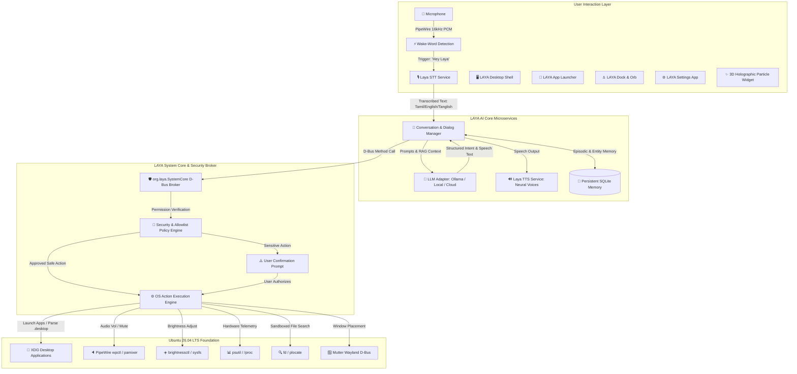

# LAYA OS Architecture Blueprint

> **Tagline:** Intelligence Within  
> **Foundation:** Ubuntu 26.04 LTS (x86_64)  
> **Compositor / Display:** Wayland via GNOME/Mutter  
> **Interface Toolkit:** GTK4 / Libadwaita / CSS / PyGObject / PySide6  
> **System IPC:** D-Bus (`org.laya.SystemCore`)  
> **Audio Subsystem:** PipeWire + WirePlumber  

---

## 1. System Architecture Overview

LAYA OS is designed as a cohesive, AI-native operating system where desktop interaction, voice commands, and system automation merge into an intuitive user experience. Rather than treating an AI assistant as an isolated third-party user-space app, LAYA OS places the **Laya AI Core** in direct communication with a secure, permission-governed **Laya System Core** running over systemd user sessions and D-Bus.

---

## 2. Core Architectural Pillars

### A. Operating System Foundation
- **Base OS:** Ubuntu 26.04 LTS (Kernel 6.x+, systemd init).
- **Display Server:** Wayland protocol managed by GNOME/Mutter compositor.
- **Audio Routing:** Modern PipeWire and WirePlumber for low-latency full-duplex audio stream routing (essential for real-time speech recognition and echo cancellation).
- **Package Management:** Standard Ubuntu APT repositories combined with LAYA-native `.deb` packages and Flatpak support.

### B. LAYA Desktop Environment
- **Shell & Panel:** Custom top status panel exposing system telemetry, quick-settings flyout, network controls, volume slider, and Laya AI voice activity status.
- **Application Launcher:** Full-screen and popup modal launcher built with GTK4 and Libadwaita, providing instantaneous fuzzy search across standard XDG `.desktop` entries, categorization, and integrated Laya prompt bar.
- **Dock:** Glassmorphic bottom dock featuring running application indicators, pinned favorites, and quick activation of the Laya assistant.
- **3D Particle Companion:** Interactive 60 FPS Fibonacci sphere and particle face widget rendering user speech feedback and system state changes.

### C. LAYA AI Core
- **Voice Recognition (STT):** Multi-backend adapter supporting both local offline transcription (Whisper, Vosk) and high-accuracy Indian multilingual neural ASR (Sarvam AI `saaras:v4`) for Tamil, English, and Tanglish.
- **Speech Synthesis (TTS):** Indian female neural voice synthesis supporting natural Tamil phonetics, Tanglish transliteration, Edge-TTS (`ta-IN-PallaviNeural`), Piper local TTS, and Sarvam AI `bulbul:v4-flash`.
- **Conversational Brain:** Local-first Small Language Model (SLM) orchestration via Ollama (`phi3`, `mistral`, `llama3`) and external API fallbacks.
- **Memory Engine:** SQLite persistent store tracking user preferences, application usage patterns, and session history while adhering strictly to privacy redaction rules.

### D. LAYA System Core & Security Broker
- **Zero Unrestricted Shells:** Under no circumstances does the LLM possess raw `/bin/sh` or `sudo` execution privileges.
- **D-Bus Isolation:** All system mutations occur through strictly defined D-Bus interfaces on `org.laya.SystemCore`.
- **Policy Enforcement:** Actions are classified into:
  1. *Safe Actions* (e.g., query volume, get CPU stats, open approved applications) executed immediately.
  2. *Sensitive Actions* (e.g., system shutdown, deleting files, modifying network profiles) requiring explicit user confirmation.
